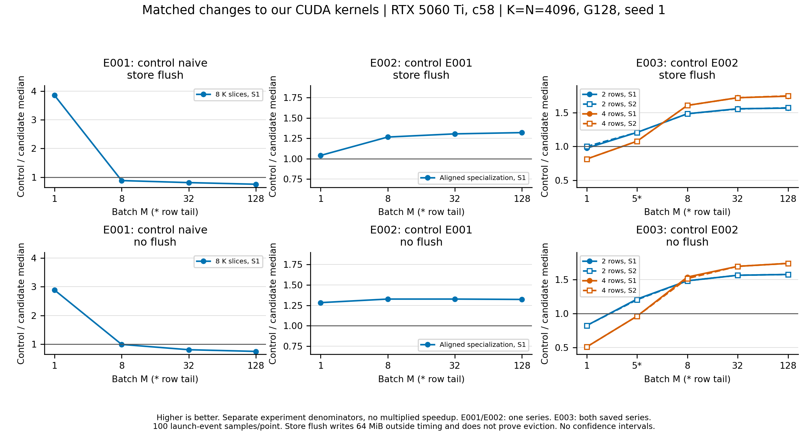
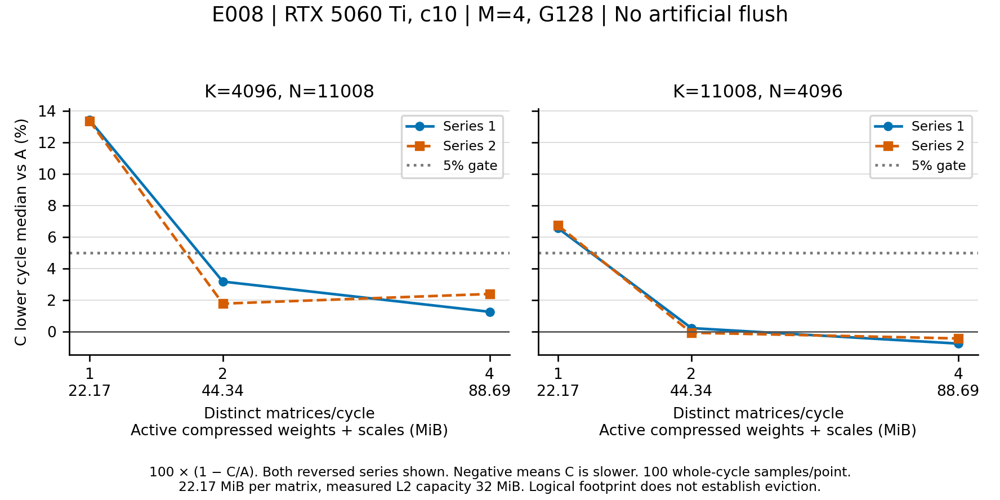
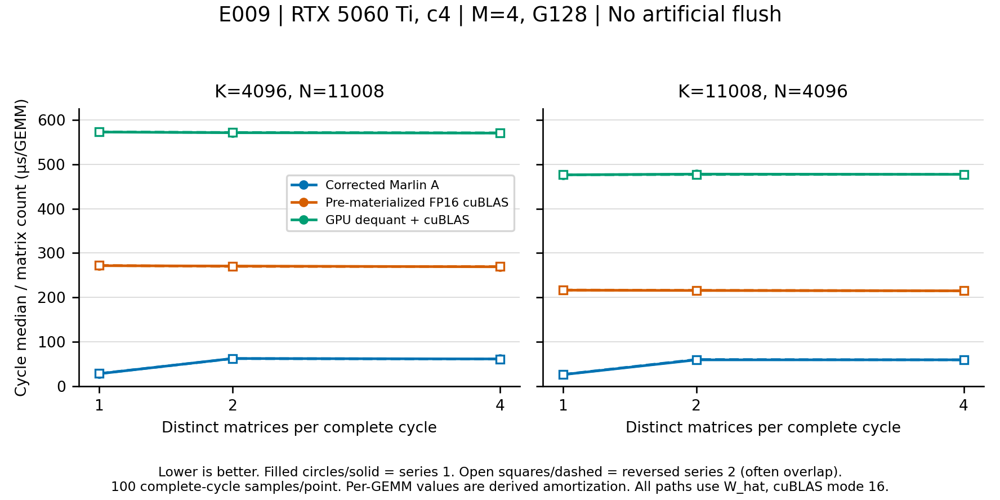
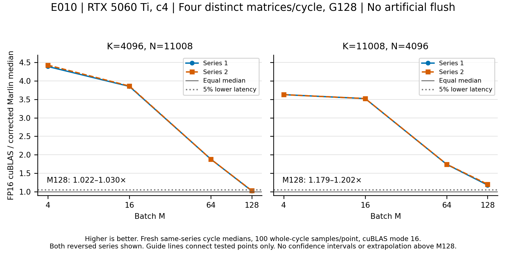

# W4A16 CUDA GEMM: project synthesis (kernel study through E012, full-model inference through E038)

**Report-draft update, 2026-11-10:** §6.8 adds the comparison with production inference stacks (E027–E028); §6.9 adds the long-context runs (E029 and the E027/E028 extensions), the gap profile (E030) and the 4-bit output head (E031); §6.10 adds output quality and head precision (E032–E035). §6 adds the full-model inference results (E013–E026) and revises the findings and limits in §5.4; §1–§5.3 are the 2026-11-08 kernel-level review and are otherwise unchanged. Figures 1–4 cover the kernel study only; the §6 tables have no figure yet.

Evidence review, 2026-11-08. Experimental endpoint: `a78c4a4`. This document uses saved results only. It introduces no GPU allocation, measurement, kernel change, dispatch policy, or E012 retry. [Figure reproduction](../scripts/reporting/README.md), [recomputed comparisons](../results/reporting/project_synthesis/matched-comparisons.csv), and [source applicability](REFERENCES.md) accompany the report.

**Central finding.** Compressed execution can substantially reduce small-batch GEMM latency in the tested setup, but the benefit depends on the implementation, weight reuse, batch size, and FP16 comparator. Our scalar CUDA changes produce useful, shape-specific improvements and clear regressions. The strongest compressed-versus-FP16 results come from maintained Marlin, whose Tensor Core implementation is upstream work. Our contribution is the retained kernel progression, lossless integration, validation and bounded synchronization correction, and controlled characterization of where benefits survive. The existing evidence supports a defensible course report. It does not establish a universal decoding speedup, an exact memory/compute crossover, or a new fast GEMM algorithm.

**Full-model finding (added 2026-11-10, §6).** Placing the corrected Marlin kernel under all 196 block projections of Qwen2.5-1.5B and replaying the decode step as a CUDA graph lowers 63-step decode latency by 45% at a 128-token context and 30% at 2048 tokens against FP16 on the same reconstructed weights, with about 58% lower peak allocated GPU memory, reproduced over five contexts, two passages and two GPUs of the same model. A profile-guided change to the decode attention path, which also helps FP16, then holds the Marlin advantage at 42–45% across all tested contexts (§6.6). The kernel alone was not enough: in eager execution its saving was hidden behind host time at short context. The path is numerically accepted only against a higher-precision control, under a gate chosen after two earlier gates against the FP16 reference rejected it; that history is part of the result. These gains are against our own FP16 path; they do not make the path competitive with production inference stacks. On the same quantized weights vLLM decodes faster than our path at every tested context, and llama.cpp and ONNX Runtime with their own 4-bit formats are faster still (§6.8), with the deficit widening up to context 16384 (§6.9). A profile then located the vLLM gap on the device and found the FP16 output head to be the largest kernel in both runtimes; quantizing that head with the project's G128 format made vLLM itself 23.1–24.4% faster, tied with ONNX Runtime INT4, at the cost of changed model outputs (§6.9). Measured WikiText-2 perplexity puts that cost at +8.6% over the FP16 head, on 4-bit blocks that are themselves 13.1% above the FP16 original; an 8-bit head in vLLM keeps about 70% of the head speedup at +0.04% (§6.10).

## 1. What problem did we implement, and what changed in scope?

### 1.1 Operation and numerical meaning

The operation is row-major `C[M,N] = A[M,K] × W_hat[K,N]`. W4A16 stores weights as four-bit codes with group-wise FP16 scales, keeps activations and outputs in FP16, and accumulates in FP32. For small M, few activation rows share a large weight matrix, so reducing stored weight bytes can matter. The fused path reconstructs weights when consumed instead of first writing a complete FP16 matrix to global memory. Whether this saves latency depends on reconstruction work, cache reuse, mapping, and the competing GEMM implementation.

The fixed G128 contract uses offset codes `q ∈ {1,…,15}` and `W_hat = FP16((q−8) × s)`. Eight consecutive K codes occupy one 32-bit word, with adjacent columns in adjacent words. The stored scale is rounded to FP16 before quantization. Weight reconstruction must round to FP16 before promotion for FP32 accumulation. Keeping `(q−8) × s` in FP32 computes a different input matrix. That reconstruction correction predates the recoverable baseline, so there is no attributable earlier failure timing to plot. [CONTRACT §1–2](CONTRACT.md#1-operation-layout-and-quantization) and [H001](EXPERIMENTS.md#h001--correct-fp16-reconstruction-before-accumulation) define these choices.

**Implementation error** compares the FP16 result with an FP64 CPU GEMM using the same W_hat. Acceptance requires `|error| ≤ 10⁻³|reference| + 10⁻³ rms(reference)`. **Quantization error** compares with the original unquantized-weight operation and is reported separately. For example, the E001 M1 naive row has relative L2 implementation error about `2.07×10⁻⁴`, while error against original weights is about `0.120`. Passing the former says nothing about model quality. Early M128 FP64 checks sample 64 rows. E002/E003 additionally compare every output bit with their retained controls. The external adapter later checks every output against FP64. These coverage levels must remain distinct.

### 1.2 From our fused kernels to a maintained implementation

The [team proposal](../results/reporting/project_synthesis/proposal-team-pdf.txt) planned a naive fused kernel, CUDA optimizations, FP16/unfused comparisons, and a roofline explanation. The earlier [solo proposal](../results/reporting/project_synthesis/proposal-earlier-solo-docx.txt) gives a more explicit M sweep. Both anticipated an RTX 3070 Ti laptop, while the team version also allowed documented ARC runs. The main evidence instead uses ARC RTX 5060 Ti GPUs. The saved team DOCX and PDF agree on the substantive plan. Their presence does not establish which version Moodle accepted.

We implemented our own scalar fused path through E003. E004 then integrated released vLLM Marlin to assess a maintained Tensor Core implementation rather than attempting its full pipeline ourselves. Upstream supplies Tensor Core tiling, fragment layouts, striped partitioning, asynchronous staging, and the core dense INT4 GEMM. Our code supplies the reference/quantization harness, lossless adapter, controlled launch ablations, validation, and the E006 barrier correction to a separately preserved local build. The source pin is vLLM v0.33.0, commit `4ba787ec9959e566d3b587a796dff07673324da5`. [The archived source and license](../results/e004_20261106/marlin-source.tar.gz) retain upstream attribution.

### 1.3 Which measurements can be compared?

All plotted cases use RTX 5060 Ti 16 GB GPUs with 36 SMs and device-reported 32 MiB L2. The figure families deliberately remain separate:

| Evidence | Node and NVIDIA driver | Inputs and timing method | Repetition and limits |
|---|---|---|---|
| E001–E003 | c58, 615.71.09 | K=N=4096, G128, seed 1. Launch-event timing, store-flush and no-flush policies | 10 warmups/100 iterations. One final E001/E002 series, two complete E003 series, including M5 tails |
| E008 | c10, 610.57.04 | M4, both rectangles, independent seed 3–6 matrices, no artificial flush, whole-cycle graph events | Two processes with reversed orders, 100 cycle samples/row |
| E009–E010 | c4, 610.57.04 | Same rectangular dimensions and seeds, corrected A versus FP16 W_hat paths, whole-cycle graph events | Fresh paired medians within each experiment, two reversed series, 100 cycle samples/row |
| E011–E012 | c4, same verified GPU/runtime identities | Fixed four-matrix endpoint workload, application-replay profiles after preceding cyclic accesses | E011 has separate fresh timing context. E012 provides diagnostic counts and failed-quality sampling, not new production timing |

The retained CUDA toolkit is 13.4.92. External comparisons use isolated Python 3.11/Torch 2.14.0+cu130, runtime 13.0.96, cuBLAS package 13.1.1.3, one process/one GPU and 16 host threads. Native kernels are CUDA C++ with preserved compiler flags. Clocks are observed, not locked. Exact identities are in each experiment's metadata and manifests, rather than inferred from a node label.

Speedup is `baseline median / candidate median`, with values above 1 favoring the candidate. Lower-latency gain is `100(1 − candidate/baseline)`. A 5% lower-latency gate therefore means speedup at least `1/0.95 ≈ 1.05263`, not 1.05. This later latency gate differs from E002/E003's explicitly predeclared 1.05 speedup criterion. For cyclic tests, `amortized latency = complete-cycle median / matrix count`. It is a derived average, not an independently timed GEMM. Setup, repacking and reference computation are outside timing. Required device reduction/lock work stays inside.

Store-flush writes 64 MiB before the start event on these GPUs. It does not prove eviction. No-flush does not prove residency. Nsight replay is a separate method. Historical c7 baselines remain context because their exact executable provenance is incomplete. No ratio below divides a new result by that historical baseline, and no cumulative speedup multiplies ratios across experiments.

## 2. What did our kernel optimizations achieve?

The naive CUDA kernel assigns one thread to each output, traverses all K, reconstructs each weight, and accumulates one output. Adjacent lanes load adjacent packed columns. At M1/K=N4096 it launches only 16 blocks and maintains a long accumulation chain. The first question was whether more parallel K work could help without changing the format.

Figure 1 compares each change with its own matched retained control. E001/E002 have only one final series. E003 shows the first complete timing series and the final series, even though profiling failed in the first attempt.

**Figure 1.** Same-executable control/candidate median speedups on c58, with both application cache policies. Each column has a different denominator. M5 is the supplemental row-tail case. Lines guide the eye between tested points. [Vector PDF](figures/project_synthesis/01_kernel_progression.pdf).

| Question and change | Matched measured result | Tradeoff and decision |
|---|---|---|
| E001: can eight within-block K slices shorten the chain and increase work availability? Use block `(32,8)`, eight contiguous packed-word intervals and a 1024 B FP32 shared reduction | M1 store-flush: naive 206.496 → inblock 53.600 µs, **3.853×**. No-flush: 110.192 → 38.176 µs, **2.886×** | M128 regresses: store-flush 2606.432 → 3452.928 µs, no-flush 2578.672 → 3445.312 µs. Keep a small-M selector, reject universal replacement |
| E002: can compile-time aligned/tail specialization remove unnecessary runtime checks? Preserve E001 mapping, arithmetic and source control | At M32/128, E001/E002 is **1.305–1.327×** across both policies. M1 store-flush 53.600 → 51.520 µs, no-flush 38.432 → 29.952 µs | Registers rise 32→34. Tail code remains available. All outputs match E001 bits. E002 is still slightly slower than same-run naive at M128. One final series limits repeatability claims |
| E003: can each reconstruction feed two or four row accumulators? Keep per-row arithmetic, expand shared partials and reduce grid-y to `ceil(M/Rows)` | Final-series E002/candidate at M32/128: **1.553–1.574×** for two rows, **1.694–1.745×** for four. Both saved timing series pass the declared larger-M criterion | Aligned registers rise 34→39, shared partials 1024→2048/4096 B. M1 no-flush regresses 29.952 → 36.416/58.944 µs. Four-row M5 no-flush regresses 107.776 → 112.192 µs. Preserve fixed selectors and the one-row control |

E001's initial tail support also slowed the naive denominator. A matched original-versus-guarded control identified the regression. Compile-time naive variants restored aligned SASS parity, then the entire final series was rerun. The pilot is preserved and excluded from Figure 1. This baseline repair is part of the experimental contribution, not another speedup to multiply.

Profiling supports the E003 reuse hypothesis within its larger-M scope. At M128, two/four rows execute 38.106%/57.207% fewer warp instructions and transfer 44.313%/66.680% fewer L2 bytes than E002. DRAM reads remain approximately 9.7–9.9 decimal MB, so the benefit is not a comparable reduction in observed DRAM bytes. Independent accumulators, fewer blocks, instruction changes and resource pressure change together. Their individual latency contributions were not isolated. The M5 regression shows directly that fewer instructions and L2 bytes do not guarantee lower latency. [Source kernels](../src/cuda/) and [E003 counter table](../results/e003_c58_20261106/profile_summary.csv) make the implementation and interpretation auditable.

## 3. What did the maintained-Marlin investigation establish?

### 3.1 Integration required numerical and timing controls

E004 losslessly reorders the existing codes and FP16 scale bits into the pinned dense `uint4b8` Marlin format. It does not requantize, change G128, or transpose the logical operation. CPU inversion recovers every code/scale bit and every reconstructed FP16 weight. Actual-call traces verify the dense Marlin operator rather than a fallback. Marlin uses FP32 local/global accumulation and reduction in this study.

E004's expanded all-row checks exposed two original-weight cuBLAS failures at M128 under its default math mode. A matched mode-0/mode-16 diagnostic reproduces the failure and passes with `CUBLAS_MATH_DISALLOW_REDUCED_PRECISION_REDUCTION` while retaining FP32 compute. The complete screen was rerun with explicit mode 16. That flag can also affect algorithm selection, so the result does not isolate one internal arithmetic cause. Later baselines inherit this setting. The original failed screen remains preserved.

Common graph-event timing reduces Python host-dispatch gaps for short kernels, and all comparators are rerun under that method. E004's 384-row screen and targeted repeats supply integration/performance context, not later corrected-body denominators. Its repeated square M64 no-flush result actually favors W_hat cuBLAS, approximately 54.75–54.77 versus 58.304 µs. Thus E010's later rectangular cyclic result must never be generalized to every shape or access policy.

### 3.2 Why reservation/grid timing stopped, and what E006 corrected

E005 asks whether excessive dynamic shared reservation restricts small-M work availability. The selected path's enabled spatial footprint is 41984 B. A requests 101376 B with 36 blocks, B requests 49664 B with 36 blocks, and C requests 49664 B with 72 blocks. All configurations share a device entrypoint. A/B isolates reservation, while B/C also changes striped partitioning, global reduction and lock coordination. Capacity for two blocks per SM is a CUDA occupancy prediction, not measured achieved residency.

E005 passes output checks, memcheck and synccheck, but racecheck reports conflicting accesses in A/B/C and the isolated official wheel. Performance stops at the predeclared gate. A passing output does not excuse an unordered shared-memory access, and a control failure does not implicate the reservation change.

E006 preserves a reproducing control and analyzes ordinary shared B-fragment reads against reduction writes into the same overlay. The existing thread-local async drain does not join other warps' ordinary shared loads. One uniform `__syncthreads()` after that drain and before overlay reuse orders the phase transition. Source control flow, shared ranges, and compiled placement support the correction. The patched A/B/C matrix passes 135 numerical rows and 162 sanitizer rows in its recorded scope, while the matched unpatched control still reports the hazard.

**The reported shared-memory hazard is removed in the tested implementation. Incorrect original output was not demonstrated.** The analyzed terminal fragment is unused, which is consistent with passing original outputs. This is neither universal correctness nor proof that the exact wheel offsets map to the same local source lines. There is no upstream-acceptance claim. The [access analysis](../results/e006_20261106/ACCESS_ANALYSIS.md), [two-line source patch](../results/e006_20261106/e006-barrier.patch), matched-source archive and original failing reports remain preserved. Corrected E006 A is the baseline for subsequent experiments.

### 3.3 Which launch/body ideas survived measurement?

E005-R1 finds no useful reservation-only improvement on its square primary cases. C supplies more observed concurrent work but gains only 0–0.237% at M1 and 2.653–2.765% at M8 without flushing. Both fail the required 5% lower-latency gate. B is 2.844% slower at M1 no-flush. E007 separately predicates unused terminal lookahead loads. Participating LDS counts fall 1.931%, but issued warp instructions rise 1.757%, register allocation remains 128, and M8 application medians tie. Both experiments remain negative under their own criteria.

The held-out rectangular lead receives independent confirmation in E005-R2 on c10. At M4/K4096/N11008, C lowers no-flush medians by 13.33%/13.28%, but store-flush medians regress 5.48%/6.06%. The reverse rectangle also passes the no-flush gate. More eligible warps and issue activity are consistent with additional ready work, despite instruction overhead. Profiles differ substantially from application timing. Changed node/driver conditions prevent assigning the difference from c58's smaller gain to one cause. This result warrants a reuse test, not automatic dispatch.

Figure 2 tests how that benefit changes when independent weights intervene. E008 uses matched A/C operands, M4, fresh seeds 3–6, two reversed series and complete-cycle timing.

**Figure 2.** C's percentage reduction in complete-cycle median relative to corrected A, with no artificial flush. Single-matrix controls reproduce the benefit, while neither multi-matrix pattern passes the 5% gate in both series. The 22.17/44.34/88.69 MiB labels are logical active weight/scale footprints. [Vector PDF](figures/project_synthesis/02_reuse_distance.pdf).

K4096/N11008 gains 13.433%/13.383% with one matrix, 3.178%/1.779% with two, and 1.260%/2.391% with four. The reverse rectangle gains 6.568%/6.741% with one matrix and loses 0.757%/0.431% with four. Two matrices exceed the 32 MiB L2 capacity arithmetically, but eviction is not measured and workspace/output reuse also changes. Single-matrix millisecond outliers remain in the samples, so median repeatability does not establish stable tail latency. C remains a reuse-dependent experimental configuration. Corrected A stays the default.

## 4. Does compressed execution still help with cyclic weights and larger batches?

### 4.1 The compressed advantage survives intervening matrices at M4

E009 compares corrected Marlin A with two FP16 alternatives computing the same W_hat: pre-materialized FP16 cuBLAS and timed GPU dequantization followed by cuBLAS. The latter uses one reusable FP16 temporary, with both operations inside the cycle events. No flush is inserted between them. Four independently allocated matrices remain live, and each pattern accesses a prefix of one, two, or four. One compressed pair occupies 22.171875 MiB, while one FP16 matrix occupies 86 MiB.

Figure 3 reports absolute amortized latency to retain the practical magnitude as reuse distance changes. The two series often overlap at this scale.

**Figure 3.** E009 complete-cycle medians divided by matrix count, in µs per GEMM, lower being better. Filled circles/solid lines show series 1, open squares/dashed lines series 2. These derived values include each path's required device work but exclude allocation/repacking. [Vector PDF](figures/project_synthesis/03_cyclic_baselines.pdf).

For two/four matrices, corrected Marlin is **3.601–4.402×** faster than pre-materialized W_hat cuBLAS and **7.958–9.327×** faster than the unfused path, passing the 5% gate for every shape/count/comparator in both series. Marlin's amortized medians rise from about 26–28 µs for repeated single weights to about 59–62 µs for longer reuse distances, yet its advantage over these FP16 alternatives remains substantial. This is performance supplied principally by upstream Marlin, evaluated by our integration and methodology. Comparing different GEMM implementations and footprints measures net compressed execution. The unfused ratio does not isolate fusion alone, and neither comparison measures tokens per second.

### 4.2 The lead narrows, but no winner reversal is observed through M128

E010 fixes four matrices and compares corrected A with pre-materialized FP16 cuBLAS at M4/16/64/128. Every denominator is fresh within E010. Figure 4 shows both reversed series and separates equal latency from the practical 5% lower-latency gate.

**Figure 4.** FP16 cuBLAS cycle median divided by corrected Marlin cycle median, higher being better. All measured points exceed 1. No confidence intervals or extrapolation are implied. [Vector PDF](figures/project_synthesis/04_batch_speedup.pdf).

| K / N | M4 speedup, S1 / S2 | M16 | M64 | M128 | M128 lower-latency gain |
|---|---:|---:|---:|---:|---:|
| 4096 / 11008 | 4.390 / 4.428 | 3.851 / 3.862 | 1.878 / 1.878 | 1.022 / 1.030 | 2.166% / 2.903% |
| 11008 / 4096 | 3.629 / 3.628 | 3.521 / 3.523 | 1.738 / 1.742 | 1.179 / 1.202 | 15.203% / 16.808% |

The first rectangle loses its **5% practical advantage** at M128 while retaining a lower measured median. It does not become slower. There is no agreed winner reversal between adjacent initial points, so the predeclared rule runs no midpoint. Neither the exact 5% boundary nor an actual winner crossover is localized, and nothing is established above M128.

Untimed actual-call traces verify the changing Marlin specialization: eight-row 128K×128N at M4, 16-row 128K×128N at M16, and 64-row 64K×256N at M64/M128. M128 executes two 64-row tiles inside one kernel. All use 36 blocks, 256 threads and 101376 B dynamic shared reservation. The transition is verified selection evidence, not itself a bottleneck explanation. Relevant racecheck covers one representative matrix at every shape/M. Full four-matrix numerical, memcheck and synccheck coverage remain separate. The original incomplete composed racecheck is not a pass.

### 4.3 Profiles explain parts of the trend, not critical-path fractions

E011 supplies eight endpoint profiles with complete operation coverage and 16 separate fresh timing rows. Application replay repeats preceding cyclic accesses on every counter pass, selecting operation four of the final cycle. Those profiles are not a direct measurement of E010's cache contents or latencies.

**Measurements:** Marlin DRAM reads increase only 0.695%/1.138% from M4 to M128, roughly 22.21 → 22.37/22.46 MiB per selected operation. Executed warp instructions increase 3.039×/3.025×, and Tensor instructions increase 16× in both orientations. Useful `2MNK` arithmetic rises 32×. L2 traffic and writes also increase. Tensor-pipe active cycles rise, but that metric is not peak FLOP utilization, and instruction counts across specializations are not common FLOP units.

**Interpretation:** These observations support increased instruction/compute pressure as M grows over nearly constant serviced DRAM reads. They do not establish that every read is a weight, a unique saturated resource, or an exact memory/compute crossover. At M128, Marlin application latency is similar across orientations, while cuBLAS is slower for K11008/N4096. Traces show different cuBLAS kernel families, with changed traffic and available work. Thus shape-dependent FP16 selection contributes to the relative gap. Layout, dispatch, traffic and scheduling vary together, so the profiles do not isolate one cause. At M4 one cuBLAS operation has a GEMM plus split-K reduction, both included in its profile. Its reduction accounts for only 2.62% of the summed profiler kernel duration and cannot alone explain the full gap.

Profiler sums exceed derived application times by 1.13–6.69%. That difference is not a reduction/epilogue decomposition. Modeled scratch requests are logical source-derived traffic, not measured DRAM bytes or phase time. Similar implementation latencies are not proof of a physical memory/compute boundary.

E012 attempts finer source-PC attribution without changing the kernel. All four instruction captures correlate to source, but inline caller ambiguity remains large. Known main-loop counts explain 69.91%/71.00% of the instruction increase, while conservative ownership lower bounds are only 48.42%/48.89%, below the majority criterion. Neither a firm majority attribution nor rejection of that hypothesis follows. Known coordination/epilogue instruction shares of 1.15–2.21% are not runtime fractions or a bound on critical-path cost.

All eight unpatched sampling captures fail the zero-dropped-data quality gate, despite zero reported overflow. Dropped bytes range from 72292 to 598942. M128 source coverage is 91.17–91.58%, below 95%. The unresolved all-ones PC remains in the denominator. Stable-looking sample shares cannot repair loss or establish unbiased sampling. No accepted stall-time breakdown, instruction-cache diagnosis, or optimization follows. E012 stays inconclusive and is not restarted for this report.

## 5. What are our contributions, and what is actually left?

### 5.1 Claim–evidence–limitation ledger

The ledger distinguishes implemented work, measured characterization and upstream performance. Linked paths are exact repository artifacts. Figure calculations also retain their input hashes in [figure-inputs.sha256](../results/reporting/project_synthesis/figure-inputs.sha256), with supplementary recomputations in [supporting-evidence.json](../results/reporting/project_synthesis/supporting-evidence.json).

| Claim and ownership | Evidence artifacts | Limitation |
|---|---|---|
| Our quantization/reference and reconstruction contract distinguish implementation error from quantization error | [src/quant.cpp](../src/quant.cpp), [src/reference.cpp](../src/reference.cpp), [baseline_c7.csv](../results/baseline_c7.csv), [CONTRACT](CONTRACT.md) | No full-model accuracy evaluation. Pre-correction failure provenance is unavailable |
| Our in-block K split improves M1 but regresses larger M | [w4a16_inblock.cu](../src/cuda/w4a16_inblock.cu), [final timings.csv](../results/inblock_c58_20261106_final/timings.csv), [pilot control](../results/inblock_c58_20261106/control_original.csv), [check.log](../results/inblock_c58_20261106_final/check.log) | One final timing series. M128 FP64 checks sample rows. Pilot's regressed denominator is excluded |
| Our specialization improves the preserved E001 aligned path | [specialized kernel](../src/cuda/w4a16_inblock_specialized.cu), [E002 timings.csv](../results/e002_c58_20261106/timings.csv), [SASS summary](../results/e002_c58_20261106/sass_summary.json) | One series, one main shape/seed. Full control-bit agreement is not independent full-row FP64 validation |
| Our row reuse improves larger M and regresses small/tail cases | [row kernel](../src/cuda/w4a16_inblock_rows.cu), [first timings](../results/e003_c58_20261106_attempt1/timings.csv), [final timings](../results/e003_c58_20261106/timings.csv), [profiles](../results/e003_c58_20261106/profile_summary.csv) | Coupled instruction/resource/block changes. No universal row-count dispatcher |
| Our adapter losslessly integrates upstream Marlin and compatible FP16 controls | [E004 adapter/harness](../scripts/e004/bench.py), [source archive](../results/e004_20261106/marlin-source.tar.gz), [screen.jsonl](../results/e004_20261106/screen.jsonl), [reduction diagnostic](../results/e004_20261106/cublas_reduction_diagnostic.json) | Upstream implements the high-performance GEMM. Explicit cuBLAS mode 16 and graph events are benchmark conditions |
| Our source-supported E006 correction removes the reported hazard in tested cases | [ACCESS_ANALYSIS.md](../results/e006_20261106/ACCESS_ANALYSIS.md), [barrier patch](../results/e006_20261106/e006-barrier.patch), [control report](../results/e006_20261106/control_square.log), [corrected report](../results/e006_20261106/patched_square.log), [analysis.json](../results/e006_20261106/analysis.json) | Incorrect original output not demonstrated. No universal correctness or upstream acceptance claim |
| Our reservation/grid and terminal-lookahead tests produce useful negative results | [stopped E005 gate](../results/e005_20261106/GATE1.md), [R1 comparisons](../results/e005_r1_20261106/comparisons.csv), [E007 comparisons](../results/e007_20261106/comparisons.csv), [E007 profiles](../results/e007_20261106/profile_summary.csv) | Failed primary latency criteria remain failed. Higher activity/fewer participating loads do not override them |
| Our characterization bounds C's gain by access pattern | [R2 comparisons](../results/e005_r2_c10_20261106/comparisons.csv), [E008 series1](../results/e008_c10_20261106/series1.jsonl), [series2](../results/e008_c10_20261106/series2.jsonl) | No physical eviction proof, stable tails, general decoding claim or dispatch |
| Upstream Marlin, with our correction/integration, beats these cyclic FP16 baselines at M4 | [E009 series1](../results/e009_c4_20261107/series1.jsonl), [series2](../results/e009_c4_20261107/series2.jsonl), [analysis](../results/e009_c4_20261107/analysis.json) | Net implementation comparison, not an invented Marlin speedup or fusion-only ablation |
| Our batch characterization finds narrowing without a winner reversal through M128 | [E010 series1](../results/e010_c4_20261107/series1.jsonl), [series2](../results/e010_c4_20261107/series2.jsonl), [selection trace](../results/e010_c4_20261107/validation_M128_K4096_N11008.trace.json) | Two rectangles/four synthetic matrices. Sub-5% lead is still a lead. No larger-M claim |
| Our profile review supports increased work and a cuBLAS-selection contribution, with unresolved attribution | [E011 profile-analysis.json](../results/e011_c4_20261107/profile-analysis.json), [source model](../results/e011_c4_20261107/source-partitions.json), [E012 attribution.json](../results/e012_c4_20261107/attribution.json), [sampling table](../results/e012_c4_20261107/sampling-quality-table.md) | Aggregate/source counts are not critical-path time. E012's failed-quality samples cannot establish a bottleneck |

These are implementation, integration and experimental-analysis contributions suitable for a course project. Established CUDA techniques, upstream Marlin performance and reproducible negative results should receive accurate credit. The record does not support describing every result as novel research.

### 5.2 What do the actual course documents require?

The saved Fall 2026 course deck is available, so requirements need not be invented. [Selected page extracts](../results/reporting/project_synthesis/course-guidelines-excerpts.txt) and [original paths/SHA256 values](../results/reporting/project_synthesis/requirements-sources.json) make this review portable. Page numbers below refer to PDF pages, not an inferred current Moodle rubric. The deck calls for a one-page proposal, a four-minute talk plus 30 seconds Q&A, and a final report of at least four ACM two-column pages including figures/tables but excluding references, submitted with code. It asks for baseline timing, speedup/scaling, setup and profiler-supported optimization evidence. It restricts the implementation to C/C++. Our numerical kernels are CUDA C++, while Python is the external measurement/analysis driver and should be disclosed.

The deck also explicitly asks for a timed serial baseline and worker-count scaling (pages 22–24). Our naive baseline is parallel GPU code, cuBLAS is an optimized GPU comparator, and the CPU FP64 reference uses OpenMP without an established serial timing series. Batch-size scaling varies the workload, not the number of workers. The synthesis therefore cannot certify strict compliance with those two lines. The team proposal also promises FP64/FP32 cuBLAS context and a roofline/crossover analysis, which the completed study has not supplied. Those are proposal gaps, not universal course requirements. Double buffering and Ozaki comparison were explicitly conditional/optional.

### 5.3 Ranked completion gaps

| Rank | Deliverable or missing evidence | Concrete reason and smallest completion action |
|---|---|---|
| **Required** | Final ACM report and code submission package | Course pages 18–19 require at least four ACM two-column pages plus code. This synthesis is source material, not that formatted submission. Convert it into the report with selected figures, references, exact build/reproduction instructions and upstream licensing |
| **Required** | Slides and presentation preparation | Course page 18 specifies four minutes plus Q&A. Build a compact story around the numerical contract, our measured changes, upstream attribution, reuse dependence and batch narrowing |
| **Required to resolve before claiming compliance** | Serial-baseline and worker-scaling interpretation | The saved guidelines explicitly request them. Obtain instructor/course clarification for this CUDA study, or separately authorize the smallest matched same-operation single-thread CPU baseline and meaningful worker-count study. No existing batch plot should be relabeled as strong/weak scaling. This task performs neither measurement |
| **Required if submitting as a pair** | Accurate individual contribution statement | The team proposal names two students and the guidelines expect clear ownership. Repository evidence does not establish each student's contribution. The authors must supply this statement rather than having an agent invent it |
| **Useful** | Reconcile proposal deviations explicitly | State the ARC GPU change, maintained-Marlin extension, CPU FP64 substitute for proposed FP64/FP32 cuBLAS context, and unestablished roofline/crossover. This is a scope statement, not a reason to implement all originally listed techniques |
| **Useful if a roofline claim is retained** | Applicable measured/specification ceilings and finite traffic model | No validated roofline artifact currently establishes the promised transition. A separately scoped analysis must use consistent GPU instruction/clock/bandwidth conventions and label modeled versus measured traffic. Do not manufacture a crossover from parity or Tensor activity. Removing the unsupported claim requires no new measurement |
| **Useful** | Submission-level clean-checkout reproducibility audit | Figures regenerate offline and experiment manifests preserve provenance. Packaging the retained external build/dependency instructions and license, then checking links and artifact availability from the final package, matters more now than another optimization |
| **Optional** | Additional M points, GPUs, real layer/model inputs or clock-controlled repeats | They would broaden applicability or precision. They are not needed for the bounded saved-data claims and are not explicitly required by the reviewed deck. Near-5% decisions deserve controlled repeats only if promoted to policy claims |
| **Optional** | Further source-PC/critical-path attribution | It would strengthen a mechanistic explanation, not the measured latency comparisons. Any retry needs a separately authorized quality pilot. Do not restart E012 automatically |

**Completion decision.** The existing implementation and evidence are sufficient to write a defensible, bounded course report now. Submission completeness still depends on the formatted report, presentation, code packaging, and resolving the serial-baseline/scaling wording. The single most important next task is to produce the ACM report draft from this synthesis and explicitly settle that rubric question before calling the project submission-ready. No additional optimization is necessary. No missing GPU measurement is automatically justified by this review. If the course requires a literal serial/worker study, that is the narrow missing measurement with a concrete compliance purpose. New inference measurements are necessary only for an inference claim, which this report does not make.

### 5.4 Findings and limits to carry into the final report

*Kernel study (E001–E012):*

1. Our own kernels demonstrate shape-specific gains from within-block K parallelism, aligned specialization and row reuse, with preserved regressions and matched controls.
2. Lossless Marlin integration and a source-supported synchronization correction enable a better validated comparator. Its core high performance remains upstream work.
3. Weight reuse distance removes C's substantial launch-policy advantage, while corrected A retains a strong M4 advantage against the established FP16 cyclic baselines.
4. Larger M narrows the relative advantage without a measured winner reversal through M128. Counts and aggregate profiles support bounded explanations, while exact critical-path attribution remains open.

*Full-model inference (E013–E035, §6):*

5. The corrected Marlin kernel passes every same-input operator check inside the model, yet the model's logits differ from the FP16 reference at the level of propagated FP16 rounding; Marlin-free higher-precision controls differ from that reference just as much. An elementwise logit gate against the FP16 path cannot separate the two.
6. Eager Marlin decode is host-bound. Its gain over FP16 is 4–6% at a 128-token context and 29% at 2048, and graph replay turns that into 45% and 30%; FP16 gains under 2% from the same replay.
7. The graph-replayed gain is a near-constant 4.4–4.5 ms per decode step and is reproduced in all 28 tested cells across contexts, passages, run order and a second GPU.
8. Profiling attributes the context-proportional cost to single-query attention; computing it directly makes decode nearly flat in context and keeps Marlin's advantage over FP16 at 42–45% at every tested context. The remaining step is Marlin projections plus the unquantized output head.
9. Against production stacks the path is slower: on the identical quantized weights our decode takes 36.9–51.4% longer than vLLM's at contexts 128–2048 (a 1.4–2.0 ms per-step gap), and llama.cpp and ONNX Runtime with their own 4-bit formats are faster still (§6.8); the deficit widens to context 16384, where our 4-bit path is slower even than their FP16 paths (§6.9).
10. The vLLM gap lies on the device: unmerged projections (196 Marlin calls per step against 112) and 1264 small kernel launches against 276 mostly fused ones; the FP16 output head is the largest kernel in both runtimes (E030). Quantizing it with the project's G128 format through Marlin lowers decode 14.7–17.1% in our path and 23.1–24.4% in vLLM, but changes model outputs (E031, §6.9).
11. Output quality is measured (E032): WikiText-2 perplexity rises 13.1% from the 4-bit blocks and a further 8.6% from the 4-bit head, both "substantial". No uncalibrated 4-bit head variant gets under 5% (best +5.82%, E034); an 8-bit head costs +0.04% and in vLLM keeps about 70% of the head speedup (15.6–16.5% below stock vLLM, E035). These bound the project's plain round-to-nearest quantizer, not 4-bit quantization in general (§6.10). With calibration (E036): a GPTQ-style calibrated quantizer in the identical 4-bit group-128 format brings the head's cost from +8.60% to about 1% (+1.03% on plain-rounded blocks, +0.89% on calibrated blocks: passes its 5% criterion) and the blocks' cost from +13.12% to +6.77% (still "substantial": fails its 5% criterion); whole model +7.72% against +22.84%. Quality only: the calibrated tensors were not timed or gated, equal speed is expected from the identical format, not measured; calibration used the train split of the same corpus (in-domain). Out-of-domain and timed (E037/E038): with calibration text from a different corpus (C4) and the variant chosen on the validation split, the best of ten calibrated quantizers in the same 4-bit format (GPTQ with activation ordering and staged projections) costs +5.62% in the blocks (still "substantial": fails its 5% criterion; plain rounding +13.12%, E036 in-domain +6.77%) and +1.57% in the head (passes; plain rounding +8.60%); whole model +7.28% against +22.84%. E038 then gated and timed that checkpoint on c10: the E021-style gate is accepted in all four cases, its decode medians are within 0.3% of the plain-rounded tensors' in all 64 cells (ours and vLLM, FP16 and 4-bit head, contexts 128/2048), and the head gain is reproduced on it (vLLM 23.1–24.2%, ours 14.7–17.1%). A signed-gradient rounding variant of my own did not help (+8.25%); that is not a measurement of the published AutoRound.

Limits of the kernel study are synthetic inputs, few shapes and one principal GPU model, unlocked clocks, limited repeated series, benchmark-specific cuBLAS settings, excluded setup/repacking costs, incomplete historical provenance and selected sanitizer/reference coverage, with no applicable validated roofline/crossover classification and no accepted E012 stall attribution. Limits of the full-model results are one model, batch size 1, 64 generated tokens, two passages, one GPU model, a post hoc acceptance gate, one corpus and one metric for quality (perplexity only, uncalibrated quantizer), no sanitizer or trace coverage under graph replay, and no stable-tail claim. Historical failed, stopped and inconclusive results remain part of the evidence.

## 6. Does the compressed kernel speed up full-model inference? (E013–E035)

### 6.1 Workload and compared paths

The model is `Qwen/Qwen2.5-1.5B` (revision `8faed761…`), FP16, PyTorch 2.14.0+cu130, Transformers 4.57.1, batch size 1. A request is a fixed prompt of 128–2048 tokens, an eager prefill that yields token 1, and 63 cached decode forwards with a static key/value cache; greedy tokens, no early stop. Two fixed text passages ("primary", "held-out") are truncated to each context length. All seven projections in each of the 28 blocks, 196 linear layers, are quantized once under the G128 contract. Embedding, the tied output head, norms, attention and caching stay FP16 and common.

| Path | Projection weights | Projection GEMM |
|---|---|---|
| O | original FP16 | PyTorch FP16 |
| R | FP16 reconstructed from the INT4 codes and scales (W_hat) | PyTorch FP16 |
| Q | the same codes and scales, packed | corrected E006 Marlin A, unchanged |

R versus Q isolates the execution path on identical quantized weights; O versus R is the quantization change and is descriptive only. A leading G (GR, GQ) means the decode step is captured once and replayed per token with `torch.cuda.CUDAGraph`. Decode time is the synchronized wall time of the 63 cached forwards; gains are `100(1 − candidate/baseline)` on medians of 20 requests after 3 warmups, one process per cell, two reversed series. Timing nodes are c7 and c52 (RTX 5060 Ti, drivers 610.57.04 and 615.71.09).

### 6.2 What did not help the FP16 model

| Experiment | Change | Result |
|---|---|---|
| E013 | smaller existing Marlin tile at M128 | 7.6–8.7% slower in both rectangles and series; rejected |
| E014 | `torch.compile` static decode | exact tokens, but 415 logits outside the elementwise bound at context 2048; stopped, no timing |
| E015 | per-token CUDA-graph replay of the FP16 decode step | bitwise-equal logits; 1.8–1.9% lower decode at 128, 1.1–1.3% at 2048; below 5% |
| E016 | one graph covering all 63 steps | −0.2% to +0.05% versus per-token replay; setup 2.5–3.3 s; no gain |

These bound what host-overhead removal alone buys an FP16 model on this GPU: under 2%, because its decode step is limited by reading about 2.6 GB of projection weights per token.

### 6.3 Numerical acceptance: two rejections, a diagnosis, and a disclosed third gate

**E017 (rejected).** The first Marlin request passes every operator check and produces the same 64 tokens as R, but 591 of 9,723,904 logits exceed the predeclared elementwise bound `|Q−R| ≤ 0.03 + 0.01|R|` (relative L2 0.00224 against a 0.003 limit). No timing was released.

**E018 (diagnosis).** One process holding both paths reproduces the E017 tensors bitwise. Feeding R's activations to Marlin at every one of 12,544 projection calls gives zero violations of the unchanged GEMM tolerance for either path, with equal error against FP64 (median relative L2 2.07×10⁻⁴). Replacing the projection GEMM by an FP32- or FP64-accumulated product on the same weights, with no Marlin involved, moves the logits just as far from R (relative L2 0.00224 and 0.00226) and violates the same bound at 667 and 102 values. The divergence is the propagation of ordinary FP16 rounding differences through 28 blocks, not a kernel or integration defect.

**E019 (rejected).** A second gate, declared after E018, required agreement with R's tokens and that Marlin be no farther from the FP64 control than the Marlin-free paths. It rejected both contexts: at context 128 on the held-out passage R's own top two logits are an exact FP16 tie at one step, which Marlin and both higher-precision controls resolve the other way; at context 2048 Marlin missed the distance comparison by 3×10⁻⁶. No timing was released under it.

**E021 (accepted, post hoc).** The third gate judges Marlin against the FP64-projection control instead of R: identical greedy tokens (or a first difference only where the control's own logits differ by less than the E017 bound), relative L2 ≤ 0.003, every same-input operator call within the GEMM tolerance, bitwise repeatability, intact workspace guards and state invariants. All ten cases pass (contexts 128–2048, two passages), with identical tokens and relative L2 0.0019–0.0026; R sits at the same distance from the control (0.0021–0.0024). Six of the ten cases used contexts never run before. **This gate was written after seeing the earlier failures, and four of its cases were known to satisfy it; E017 and E019 remain failed under their own rules.** Every speed number below depends on it.

### 6.4 Timing

**Eager Marlin (E020).** Against eager R, decode is 3.6%/4.6% lower at context 128 and 28.9%/29.0% lower at context 2048; later repeats put the short-context gain at 4.7–5.8%, so it sits at the 5% threshold and is not claimed. Peak allocated memory falls from about 3.0–3.2 GiB to 1.2–1.4 GiB. Prefill at 2048 is about 3% slower.

**Why short context showed so little (E022).** The 196 projections of one decode step take 6.96 ms for FP16, 28% of it host time, and 2.95 ms for Marlin, 99% of it host time. Marlin saves about 4 ms of device work per step, but an eager step carries roughly 9.5 ms of Python and launch time, which hides it until the FP16 device work grows past that at long context.

**Graph replay (E023).** Marlin's external launches can be captured; replayed logits are bitwise equal to eager Marlin. Decode medians, series 1 / series 2, c7:

| Context | R eager | GR | Q eager | GQ | GQ below R | GQ below GR |
|---|---:|---:|---:|---:|---:|---:|
| 128 | 626.2 / 626.8 ms | 614.3 / 615.0 | 596.1 / 593.3 | 342.4 / 343.0 | 45.3% / 45.3% | 44.3% / 44.2% |
| 2048 | 909.8 / 911.4 ms | 898.6 / 900.0 | 646.1 / 647.7 | 632.6 / 633.0 | 30.5% / 30.5% | 29.6% / 29.7% |

Replay passes its own criterion (≥5% below eager Marlin) at context 128 (42%) and misses it at context 2048 (2.1–2.3%): at long context the Marlin step is already device-bound.

**Robustness (E024).** The same four variants over contexts 128, 256, 512, 1024, 2048, both passages and two reversed series on c7 (80 cells), and at 128/2048 on c52 with a different driver (32 cells). All three predeclared criteria hold: GQ is ≥5% below both FP16 variants in all 28 (context, passage, series) cells; GQ's slowest request beats FP16's fastest in every cell; repeated cells are within 0.7% of E023.

| Context | 128 | 256 | 512 | 1024 | 2048 |
|---|---:|---:|---:|---:|---:|
| GQ decode, ms (c7) | 342.5–343.0 | 362.9–363.5 | 399.9–400.6 | 477.1–477.2 | 633.9–634.0 |
| GQ below R | 45.3% | 43.6–43.8% | 41.3–41.4% | 37.3–37.4% | 30.4–30.5% |
| GQ below GR | 44.2–44.3% | 42.6–42.7% | 40.3–40.4% | 36.4% | 29.6% |
| second GPU (c52), GQ below R | 45.7% | — | — | — | 30.8–30.9% |

Passage and run order change the medians by under 0.2%. The gain is a near-constant 4.4–4.5 ms per step; the percentage falls with context only because both paths share a cost proportional to context length.

### 6.5 Where the remaining time goes (E025)

Device time per eager Marlin decode step, one profiled request per context on c9:

| Component | context 128 | context 2048 |
|---|---:|---:|
| Marlin kernels, 196 projections | 2.44 ms | 2.49 ms |
| FP16 output head (151936×1536 GEMV, not quantized) | 1.17 ms | 1.17 ms |
| Attention kernel | 0.47 ms | 4.00 ms |
| Copies, including key/value head expansion | 0.37 ms | 1.42 ms |
| Everything else | 1.08 ms | 1.10 ms |
| Total | 5.53 ms | 10.18 ms |

The totals match the replayed step times (5.44 and 10.06 ms), so under replay the step is essentially its device time. Attention and the head-expansion copy account for all of the context-proportional cost. These are kernel durations under an eager profiler, not replay latencies, from seven decode steps each.

### 6.6 Acting on the profile: direct single-query decode attention (E026)

For decode steps only, attention is computed directly as `softmax(scale·q·Kᵀ + mask)·V` on the two stored key/value heads with FP32 scores, instead of the library's general attention call after expanding to twelve heads. Prefill is unchanged. All ten validation cases pass the E021 gate against the stock-attention control, at the same distance as before (relative L2 0.0020–0.0025). Decode medians on c7, ranges over both passages and two reversed series (A = new attention):

| Context | GR | GQ | GRA | GQA | GQA below GQ | GQA below GRA | GQA below GR |
|---|---:|---:|---:|---:|---:|---:|---:|
| 128 | 614–615 ms | 342–343 | 596–597 | 325–326 | 5.0% | 45.4–45.5% | 47.0–47.1% |
| 256 | 633–634 | 363–364 | 600–601 | 329 | 9.4% | 45.2% | 48.0–48.1% |
| 512 | 671 | 400–401 | 607 | 334–335 | 16.4% | 44.8–44.9% | 50.1–50.2% |
| 1024 | 749–750 | 476–477 | 627 | 351 | 26.3–26.4% | 44.0–44.1% | 53.2% |
| 2048 | 900 | 634 | 650 | 374 | 41.0% | 42.5% | 58.5% |

The change passes its 5% criterion against stock-attention graph-Marlin at contexts 256–2048. At context 128 it measures 5.0% on c7 and 4.9–5.1% on a second node (c9), where two of four cells fall below 5%, so it is not a robust pass there. The context-2048 result replicates on c9 (41.1–41.3%), as do the gains against FP16 at both contexts. It is an inference-path change, not a W4A16 kernel result: FP16 gains 3–28% from it as well. Its relevance to the compressed kernel is that, with the context-proportional cost removed, Marlin's advantage over FP16 stays at 42–45% at every context instead of fading to 30%. Decode time becomes nearly flat in context (325 to 374 ms).

### 6.7 Contributions and attribution for the full-model part

| Claim and ownership | Evidence | Limitation |
|---|---|---|
| Our integration runs corrected Marlin under all 196 projections on identical quantized weights, with a matched FP16 path | [E017 tooling](../scripts/e017/README.md), [bridge record](INFERENCE_MARLIN_BRIDGE.md) | Upstream Marlin supplies the kernel; our part is the E006 barrier, packing, wrapper and checks |
| Our diagnosis attributes the model-level divergence to propagated rounding | [E018 summary](../results/e018_20261109/full-333413/out/summary.json) | One request for the per-call probe in E018; extended to ten requests in E021 |
| Our acceptance against an FP64-projection control | [E021 verdict](../results/e021_20261110/full-334098/out/verdict.json), failed gates in [E017](../results/e017_20261109/) and [E019](../results/e019_20261109/) | Third gate, post hoc; not a model-quality result |
| Our measurement that eager Marlin decode is host-bound, and that replay exposes the kernel's saving | [E022](../results/e022_20261110/), [E023](../results/e023_20261110/) | PyTorch supplies graph capture; random inputs in E022 |
| Our robustness evidence | [E024](../results/e024_20261110/) | One model, batch 1, 64 tokens, one GPU model on two nodes |
| Our device-time breakdown | [E025](../results/e025_20261110/) | One profiled request per context, eager, instrumented |
| Our decode-attention restructuring chosen from that breakdown | [E026](../results/e026_20261110/) | PyTorch supplies the kernels; benefits FP16 too; batch 1, one query token |
| Our external comparison with vLLM on identical weights, and with llama.cpp and ONNX Runtime | [E027](../results/e027_20261110/), [E028](../results/e028_20261110/) | A negative result: our path is slower than all three, at every context 128–16384. The stacks are upstream work; only the conversion, harness and measurement are ours. llama.cpp/ORT use their own quantizers |
| Our long-context measurement of our own paths | [E029](../results/e029_20261110/) | Raised operator row bound (recorded deviation); no sanitizer at these prefill sizes; super-linear growth beyond 8192 unprofiled |
| Our kernel-level location of the per-step gap to vLLM | [E030](../results/e030_20261110/) | Diagnostic; one passage, one node, in-process vLLM, grouping by kernel name; the vLLM structure it reflects (merged projections, compiled fused kernels) is upstream design |
| Our test of a 4-bit output head, in our path and inside vLLM | [E031](../results/e031_20261110/) | **Ours:** the idea tested here, the head codes/scales from the project's own G128 quantizer, the checkpoint conversion, the FP64-control validation gate and the measurement. **Upstream:** the Marlin kernel that executes the head, the vLLM runtime and its existing `lm_head` quantization support. Quantized output heads are common in other stacks (llama.cpp, ORT quantize theirs), so the novelty is the measurement on this stack, not the concept. Changes model outputs; +8.6% perplexity (E032); tie, not win, versus ORT INT4 |
| Our quality measurement and head-precision follow-ups | [E032](../results/e032_20261110/), [E033](../results/e033_20261110/), [E034](../results/e034_20261110/), [E035](../results/e035_20261110/) | **Ours:** the perplexity harness, the head variants, the 8-bit head conversion and the measurements. **Upstream:** vLLM, its 8-bit Marlin kernel and per-module `dynamic` override. One corpus, one metric, uncalibrated quantizer; E035 is vLLM only with no project arm and no E021-style gate; E034's failed attempt 334362 is preserved |

No row above claims a speedup over the state of the art. The gains in this section are against our own FP16 path (and, up to context 8192, against llama.cpp's and ONNX Runtime's FP16 paths), plus E031's and E035's gains for vLLM over its own stock configuration, which carry measured perplexity costs of +8.6% and +0.04% over the FP16 head; the project's scalar kernels (E001–E003) were never run inside the model.

For the course requirements in §5.2–§5.3, the full-model study adds an inference claim that the kernel study did not make, so the statement there that no inference measurement is needed no longer applies; the serial-baseline and worker-scaling question is unchanged and still open.

### 6.8 Comparison with production inference stacks (E027–E028)

Every result above uses our own FP16 path as the baseline. E027 and E028 ask the question a reader will ask next: is the best path (GQA: graph-replayed Marlin with direct decode attention) faster than, or comparable to, a production inference stack? Nothing in our paths changes. Conditions: batch 1, greedy, 64 tokens, the exact input ids of our validated runs, contexts 128/512/2048 × two passages × two reversed series, 3 warmups + 20 requests per cell, our variants re-validated under E021's gate (the third, post hoc gate of §6.3; that disclosure applies to every number here) and re-timed in the same job on the same node. Predeclared outcome per context: "faster" if GQA is ≥5% below the stack in all four cells, "slower" if the stack is ≥5% below GQA in all four, "comparable" if all four are within ±5%, otherwise "mixed".

**vLLM on identical weights (E027, c9).** vLLM v0.33.0 (the wheel our Marlin build comes from) loads the project's own G128 codes and FP16 scales, converted losslessly to an AutoGPTQ-format checkpoint, and returned all 64 tokens identical to our Marlin path in every request. Decode medians, ranges over two passages and two series:

| Context | GR ms | GQ ms | GQA ms | vLLM ms | GQA versus vLLM | End-to-end GQA / vLLM ms |
|---|---:|---:|---:|---:|---:|---:|
| 128 | 616.0–616.1 | 344.1–344.2 | 326.8–327.0 | 238.1–238.8 | 36.9–37.3% slower | 342 / 250–251 |
| 512 | 672.6–673.4 | 402.0–402.2 | 335.8–336.0 | 240.8–241.1 | 39.4–39.5% slower | 379 / 277 |
| 2048 | 903.3–905.0 | 638.3–640.1 | 375.5–376.0 | 248.1–248.9 | 50.9–51.4% slower | 574 / 391–392 |

Outcome: **"slower" at all three contexts**; the hypothesis that GQA is ≥5% below vLLM is rejected. vLLM takes 3.8–3.9 ms per decode step against our 5.2–6.0 ms with the same codes, scales and upstream kernel family, so the 1.4–2.0 ms difference (calculation) lies outside the quantized weights. Where it lies has not been profiled and is not attributed.

**llama.cpp and ONNX Runtime with their own 4-bit formats (E028, c5 and c10).** These stacks cannot load our codes. llama.cpp (llama-cpp-python 0.3.36) uses its Q4_K_M quantization (5.08 bits per weight over all tensors) and ONNX Runtime GenAI 0.19.0 its builder's INT4 export; both evidently also quantize the embedding/output matrix, which our path keeps in FP16. This is therefore stack against stack (format + kernel + runtime), not identical weights.

| Context | GQA ms (c5 / c10) | llama.cpp Q4_K_M ms | ORT INT4 ms | GQA versus Q4_K_M | GQA versus ORT INT4 |
|---|---:|---:|---:|---:|---:|
| 128 | 326.4–327.1 / 326.8–327.6 | 208.5–208.6 | 185.2–185.4 | 56.5–56.9% slower | 76.5–76.7% slower |
| 512 | 335.5–336.2 / 336.1–336.7 | 210.9–211.2 | 185.1–185.3 | 59.0–59.3% slower | 81.4–81.9% slower |
| 2048 | 375.7 / 376.1–376.2 | 227.5 | 191.6–192.2 | 65.2% slower | 95.8–96.3% slower |

Outcome: **"slower" at all three contexts for both stacks.** At these contexts our 4-bit path remains faster than either stack's FP16 path (38–31% below llama.cpp FP16, 38–30% below ORT FP16), which holds only up to context 8192 (§6.9), while our own graph FP16 (GR) is 15.9–67.8% slower than theirs, so their FP16 paths are also better than ours. Leading-token agreement with ours is 64/64 except the context-128 held-out passage (46/64 for both FP16 variants, 28/64 Q4_K_M, 29/64 ORT INT4); the FP16 first-token check passed in every request.

**Limits.** One model, batch 1 (not the serving stacks' design point, and a setting that favours us), 64 tokens, one node per stack, RTX 5060 Ti only. vLLM decode is the difference of two wall times, ours a synchronized phase timer; vLLM's Marlin lacks the E006 barrier and its backbone runs under `torch.compile`; vLLM FP16 was not run. No output-quality comparison exists for any quantized model. No stack was tuned, and TensorRT-LLM and ExLlamaV2 were not attempted. Long-context runs and the gap profile are in §6.9. Failed attempts (wheel path, FlashInfer sampler JIT, llama.cpp build ISA, ORT missing `onnx-ir`) are recorded in the experiment log.

**What this means for the report.** The project does not beat the state of the art at batch 1 on this GPU. What it supports is a validated explanation of why a 4-bit kernel's saving was hidden in a plain PyTorch model (host time, then attention) and how much of it graph replay and a decode-attention change recover, plus a measured 1.4–2.0 ms per-step gap to vLLM on identical weights, located in §6.9.

### 6.9 Long context, the gap profile and a 4-bit output head (E029–E031)

**Our paths at contexts 4096–16384 (E029, c7).** Same four variants, validation accepted in all six cases under E021's gate (third-gate disclosure) with the operator's 2048-row assertion raised to 16384 (recorded deviation; no sanitizer at these prefill sizes).

| Context | GRA ms | GQA ms | GQA below GRA | GQA ms per step | Prefill share of request |
|---|---:|---:|---:|---:|---:|
| 4096 | 698.6–698.7 | 426.8–427.0 | 38.9% | 6.78 | 54% |
| 8192 | 801.6–801.7 | 540.7–540.8 | 32.5% | 8.58 | 72% |
| 16384 | 1063.6–1063.7 | 795.8–796.1 | 25.2% | 12.64 | 84% |

The Marlin saving stays 4.1–4.3 ms per step while the common cost grows. Step time follows the predeclared linear projection to 8192 and grows faster beyond it (0.50 against 0.41 ms per 1,000 tokens); the cause was not profiled.

**Production stacks at long context (E027/E028 extensions).** Outcome "slower" at every context; external tokens equal ours in every request.

| Context | GQA ms | vLLM ms | ORT FP16 ms | ORT INT4 ms | llama.cpp FP16 ms | llama.cpp Q4_K_M ms |
|---|---:|---:|---:|---:|---:|---:|
| 4096 | 428.8–429.7 | 266.3–266.5 | 549.3–550.1 | 202.5–202.8 | 567.4–567.9 | 246.6 |
| 8192 | 543.7–544.9 | 284.1–284.8 | 566.9–567.6 | 221.7–222.0 | 611.4–611.5 | 290.4–290.6 |
| 16384 | 800.9–802.6 | not run | 603.0–603.3 | 259.4–259.5 | 701.6–701.7 | 380.8–380.9 |

GQA ranges span the c9, c10 and c5 runs. At 16384 our 4-bit path is slower than both stacks' FP16 paths, so the statement that it beats their FP16 holds only up to context 8192.

**Where the vLLM gap lies (E030, diagnostic, c51).** Device kernel time per decode step on identical weights: ours 5109 / 5846 µs, vLLM 3733 / 3820 µs at contexts 128 / 2048, matching the wall-clock steps, so the gap is on the device. Of the 1376 / 2026 µs gap, 386 / 378 µs is Marlin (vLLM merges projections: 112 calls per step against our 196) and 990 / 1648 µs is everything else (276 mostly fused compiled kernels plus FlashAttention against our 1264 small launches). The FP16 output head is 1169 µs in both, the largest single kernel in either, and the one large cost vLLM had not removed.

**4-bit output head (E031, c10/c7/c9).** The tied 151,936 × 1536 head is quantized with the unchanged project G128 quantizer and executed by Marlin, in our path (GQAH) and in vLLM via `lm_head: true` (VH). The gate (E021 rule against an FP64 control with the same head weights) accepts every case; VH returns GQAH's tokens in every request. 80 cells, 1600 requests:

| Node, context | GQA ms | GQAH ms | vLLM ms | vLLM + 4-bit head ms | GQAH below GQA | VH below vLLM |
|---|---:|---:|---:|---:|---:|---:|
| c10, 128 | 326.8–326.9 | 271.4–271.5 | 237.4–238.6 | 180.7–180.8 | 17.0% | 23.9–24.3% |
| c10, 2048 | 375.4–375.6 | 320.2–320.3 | 248.6–249.2 | 190.9–191.1 | 14.7% | 23.1–23.4% |
| c7, 128 | 325.3–325.4 | 269.8 | 237.8–238.3 | 180.1–180.4 | 17.1% | 24.1–24.4% |
| c7, 2048 | 373.4–374.0 | 318.1–318.8 | 247.6–248.1 | 190.2–190.8 | 14.8% | 23.1–23.3% |
| c9, 128 | 326.7–326.8 | 271.3–271.4 | 237.6–238.2 | 180.7 | 17.0% | 23.9–24.1% |

Both arms pass 5% in every cell on every node (0.88 ms per step saved in ours, 0.92 ms in vLLM). On c10, VH is 2.4–2.5% / 0.3–0.6% below ORT INT4 from E028: a tie within the 5% rule, from separate jobs with different quantizers, not a win. Our path with the head is still 13.2–28.8% slower than stock vLLM. **The head change alters model outputs:** logit relative L2 0.123–0.170 against the FP16-head control at the first step; all 64 tokens kept in three of four cases and 47/64 in one. E032 later measured the quality cost at +8.6% perplexity (§6.10), so this is a supported decode improvement conditional on accepting that cost. It is not a repository default. Scope: one model, batch 1, 64 tokens, two passages, RTX 5060 Ti.

### 6.10 Output quality, head precision and calibration (E032–E038)

**Quality (E032, c10).** Teacher-forced perplexity on the WikiText-2 test split, 307,050 scored positions in 150 non-overlapping 2048-token windows, PyTorch FP16 on reconstructed weights:

| Model | Perplexity | Top-1 next-token accuracy |
|---|---:|---:|
| O: original FP16 | 8.606 | 53.86% |
| OH: original blocks, 4-bit head | 9.297 | 52.72% |
| R: 4-bit blocks, FP16 head (E017–E030) | 9.735 | 52.06% |
| RH: 4-bit blocks and 4-bit head (E031) | 10.572 | 50.87% |

The head adds +8.60% (RH versus R) and the blocks +13.12% (R versus O), both "substantial" under the predeclared labels (≤1% negligible, ≤5% modest); together +22.85%. E031's gain therefore stays conditional and is quoted with its +8.6% cost. Every full-model 4-bit speedup since E020 runs on a model 13.1% above the FP16 original in perplexity; the FP16 baselines ran the same reconstructed weights, so the speed comparisons remain like for like. The quantizer is plain per-group round-to-nearest without calibration, so this bounds this quantizer, not 4-bit quantization in general; llama.cpp's and ONNX Runtime's quantized models are not measured.

**Same-job ORT comparison and batch sizes (E033, c10).** Interleaved in one job, vLLM with the 4-bit head is 2.30–2.39% below ORT INT4 at context 128 and 0.20–0.41% at 2048: a tie, not a win, with different quantizers. Its gain over stock vLLM holds at batch 1/2/4/8 (16.1–24.1%), shrinking with batch, mildly at context 128 (24.1% to 22.1%) and more at 2048 (23.3% to 16.1%). Identical prompts per batch, vLLM only.

**Better 4-bit heads (E034, c51, quality only).** Against the FP16 head on the same 4-bit blocks: group 128 with error-minimizing scales +7.90%, group 32 +7.95%, group 32 with error-minimizing scales +5.82%, all "substantial"; an 8-bit group-128 head +0.04%, "negligible". The predeclared hypothesis that some 4-bit variant is "modest" is rejected. The first attempt (job 334362) stopped at its bit-for-bit control, attributed by inference to negative zero, and is preserved.

**Calibrated quantizer (E036, c10).** A GPTQ-style calibrated quantizer in the identical 4-bit group-128 format brings the head's cost from +8.60% to about 1% (+1.03% on plain-rounded blocks, +0.89% on calibrated blocks: passes its 5% criterion) and the blocks' cost from +13.12% to +6.77% (still "substantial": fails its 5% criterion); whole model +7.72% against +22.84%. Quality only: the calibrated tensors were not timed or gated, equal speed is expected from the identical format, not measured; calibration used the train split of the same corpus (in-domain). GPTQ lowers the calibration output error in all 196 projections (ratio to plain rounding 0.027–0.607, median 0.394) while the head's weight error rises from 0.122 to 0.140: it trades weight fidelity for output fidelity, which E034's weight-error search could not do. Record: [E036](EXPERIMENTS.md#e036--does-a-calibrated-quantizer-in-the-same-4-bit-format-remove-the-quality-cost).

**Out-of-domain calibration, selection and timing (E037 c4, E038 c10).** With calibration text from a different corpus (C4) and the variant chosen on the validation split, the best of ten calibrated quantizers in the same 4-bit format (GPTQ with activation ordering and staged projections) costs +5.62% in the blocks (still "substantial": fails its 5% criterion; plain rounding +13.12%, E036 in-domain +6.77%) and +1.57% in the head (passes; plain rounding +8.60%); whole model +7.28% against +22.84%. E038 then gated and timed that checkpoint on c10: the E021-style gate is accepted in all four cases, its decode medians are within 0.3% of the plain-rounded tensors' in all 64 cells (ours and vLLM, FP16 and 4-bit head, contexts 128/2048), and the head gain is reproduced on it (vLLM 23.1–24.2%, ours 14.7–17.1%). A signed-gradient rounding variant of my own did not help (+8.25%); that is not a measurement of the published AutoRound. Calibrating on C4 instead of the test corpus's train split costs 1.79 points with the unchanged quantizer (+8.56% against +6.77%). Activation ordering, shrunken scales and staged projections each help alone (+6.08%, +7.26%, +7.77%), but they are not additive: every combination with both ordering and shrunken scales is no better than none (+8.27–8.54%). In E038 vLLM decodes the calibrated checkpoint with its 4-bit head in 180.7–191.5 ms and our path in 271.0–320.2 ms; our path remains slower than stock vLLM. Limits: one model, one test corpus, validation and test from the same corpus, ten variants scored on test, contexts 128/2048 on one node, no FP16 baseline timed on the calibrated weights, E021's post hoc gate. Records: [E037](EXPERIMENTS.md#e037--which-calibrated-quantizer-in-the-same-4-bit-format-costs-least-with-out-of-domain-calibration), [E038](EXPERIMENTS.md#e038--do-the-calibrated-tensors-pass-the-gate-and-run-at-the-speed-of-the-plain-rounded-ones).

**8-bit head in vLLM (E035, c51).** The 8-bit head passes its 5% criterion in all eight cells: decode 15.6–16.5% below stock vLLM, 69.3–69.8% of the 4-bit head's 22.5–23.6% same-job gain, with all 64 tokens equal to the FP16-head reference in every request. Limits: vLLM only (our operator executes 4-bit codes only, so our path gains nothing); no logit-level check or E021-style gate for vLLM's 8-bit kernel; no same-node ONNX Runtime or llama.cpp comparison; batch 1, one node, one corpus for quality. Marlin, vLLM, its 8-bit kernel and per-module override are upstream; ours is the head quantization, conversion and measurement. Not a repository default. Untested and not authorized: a calibrated (GPTQ/AWQ-style) quantizer for head or blocks, an 8-bit arm in our own operator, mixed precision.
